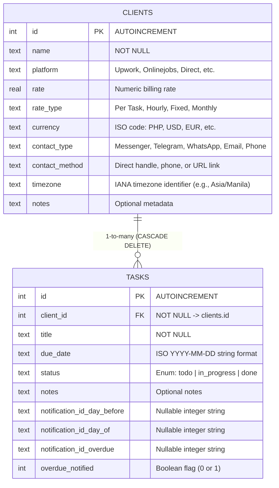

# Project Atlas — System & Architectural Specification

```yaml
project: Atlas (atlas_flutter)
type: Offline-First Freelance Operations & Client Management Application
framework: Flutter 3.x / Dart 3.11+
architecture: Layered Provider/ChangeNotifier Pattern (MVVM-derived)
database_engine: SQLite (sqflite on mobile; sqflite_common_ffi on desktop)
target_platforms: Windows Desktop, Android, iOS
source_ancestry: Migrated from Expo SDK 54 / React Native New Architecture
```

---

## 1. Executive Summary & Domain Scope

**Atlas** is an offline-first productivity and operational tracker tailored for freelance professionals, digital nomads, and independent contractors managing multi-client workflows across global time zones.

The application unifies three interdependent business domains:
1. **Client Relationship Management (CRM)** with localized timezone awareness and deep-linked communication channels.
2. **Task & Deadline Execution Tracking** with triage categorizations and automated staged reminder scheduling.
3. **Multi-Currency Invoicing & Earnings Aggregation** calculating real-time revenue breakdowns segmented by currency and period.

---

## 2. Architectural Blueprint

The codebase adheres to a unidirectional, provider-based reactive architecture:

```
┌────────────────────────────────────────────────────────┐
│                   Presentation Layer                   │
│   Screens (Home, Clients, Tasks, Profile, Scaffold)    │
│   Widgets (CustomBottomNav, TaskCard, ClientCard, etc) │
└───────────────────────────▲────────────────────────────┘
                            │ listens / dispatches
┌───────────────────────────┴────────────────────────────┐
│                    State Providers                     │
│   TaskProvider  •  ClientProvider  • PreferencesProvider│
└───────────────────────────▲────────────────────────────┘
                            │ queries / mutates
┌───────────────────────────┴────────────────────────────┐
│               Service & Persistence Layer               │
│   AppDatabase (SQLite)  • NotificationService          │
│   BackupService (JSON/Share) • DateHelpers             │
└────────────────────────────────────────────────────────┘
```

### Key Architectural Invariants
- **Local-First & Zero Cloud Dependency**: All user data, client metrics, and task statuses persist strictly on the local filesystem.
- **Cross-Platform FFI Bridge**: Desktop platforms (Windows) utilize `sqflite_common_ffi` with `sqfliteFfiInit()`, storing SQLite databases in `~/Documents/Atlas/atlas_tracker.db`. Mobile targets use native OS SQLite storage paths via `getDatabasesPath()`.
- **Reactive Decoupling**: State changes (e.g., completing a task, updating a client rate) automatically cascade listeners through `ChangeNotifier.notifyListeners()`, refreshing UI tabs without manual polling.

---

## 3. Directory Layout & Key Modules

```text
atlas_flutter/
├── lib/
│   ├── database/
│   │   └── app_database.dart         # SQLite initialization, schema DDL, query aggregations
│   ├── models/
│   │   ├── client.dart               # Client domain entity and serialization
│   │   └── task_item.dart            # Task domain entity, deadline variants, and serialization
│   ├── providers/
│   │   ├── client_provider.dart      # Client CRUD and in-memory list provider
│   │   ├── preferences_provider.dart # ThemeMode, base currency, and reminder preferences
│   │   └── task_provider.dart        # Task queries, status transitions, and revenue metrics
│   ├── screens/
│   │   ├── client_detail_screen.dart # Detailed client view, relative time, and associated tasks
│   │   ├── clients_screen.dart       # Client directory and addition trigger
│   │   ├── home_screen.dart          # Financial overview card, tabs (Today/Overdue/Upcoming)
│   │   ├── main_scaffold.dart        # Root navigation scaffold and persistent tab bar
│   │   ├── profile_screen.dart       # Settings, theme toggles, JSON backup export/import
│   │   ├── task_form_screen.dart     # Full-page task creation/editing form
│   │   └── tasks_screen.dart         # Comprehensive task management and status filtering
│   ├── services/
│   │   ├── backup_service.dart       # JSON backup export (Share) and atomic import (FilePicker)
│   │   └── notification_service.dart # Local scheduled deadline notifications (Day-before, Day-of, Overdue)
│   ├── theme/
│   │   └── app_theme.dart            # Material Design 3 palettes (warm bronze/terracotta theme)
│   ├── utils/
│   │   └── date_helpers.dart         # Pure ISO string parsing, date formatting, greetings
│   ├── widgets/
│   │   ├── client_card.dart          # Visual client summary card with task count badge
│   │   ├── client_form_dialog.dart   # Modal dialog for client creation and editing
│   │   ├── custom_bottom_nav.dart    # Floating pill navigation bar with centered quick-add action
│   │   ├── deadline_badge.dart       # Overdue, Today, and Upcoming status badges
│   │   ├── greeting_header.dart      # Dynamic time-of-day greeting and formatted date banner
│   │   ├── quick_add_dialog.dart     # Rapid modal task creation directly from bottom nav
│   │   └── task_card.dart            # Task item widget with swipe-to-delete/edit & status pills
│   └── main.dart                     # App entry point, MultiProvider registration, MaterialApp
├── windows/
│   └── runner/
│       └── main.cpp                  # Desktop runner configured to mobile phone dimensions (412x860)
└── pubspec.yaml                      # Project dependencies and asset definitions
```

---

## 4. Entity Schemas & Relational Model



---

## 5. Subsystems & Functional Capabilities

### A. Client Management Engine (`client_provider.dart`, `clients_screen.dart`, `client_detail_screen.dart`)
- **Profile Orchestration**: Full CRUD operations on client entities.
- **Deep-Link Protocol Resolvers**: Evaluates `contactMethod` string values and generates appropriate protocol URIs for OS-level dispatch via `url_launcher`:
  - `m.me/username` $\rightarrow$ `https://m.me/...` (Messenger)
  - `wa.me/phone` $\rightarrow$ `https://wa.me/...` (WhatsApp)
  - `t.me/handle` $\rightarrow$ `https://t.me/...` (Telegram)
  - `email@domain` $\rightarrow$ `mailto:email@domain`
  - Raw phone numbers $\rightarrow$ `tel:+123456789`
- **Client Financial Profiling**: Associates hourly, monthly, or task-based billing rates and currency definitions directly with client records.

### B. Task Lifecycle & Deadline Triage (`task_provider.dart`, `task_card.dart`, `home_screen.dart`)
- **Temporal State Classifications**: Evaluates `due_date` against system `DateTime.now()`:
  - `overdue`: `startOfDay(dueDate) < startOfDay(now)` and `status != 'done'`
  - `today`: `isSameDay(dueDate, now)` and `status != 'done'`
  - `upcoming`: `startOfDay(dueDate) > startOfDay(now)` and `status != 'done'`
- **Status State Machine**: Enforces valid status transitions across `todo`, `in_progress`, and `done`.
- **Interactive Gestures**: Includes swipe-to-delete (with confirmation dialog), swipe-to-edit, and single-tap segmented status pill controls.

### C. Financial Aggregator (`AppDatabase.getEarningsSplit()`)
- Aggregates income strictly from tasks with `status = 'done'`.
- Dynamic temporal SQL grouping:
  - **Weekly**: `strftime('%Y-%W', t.due_date) = strftime('%Y-%W', 'now', 'localtime')`
  - **Monthly**: `strftime('%Y-%m', t.due_date) = strftime('%Y-%m', 'now', 'localtime')`
- Emits partitioned `CurrencySplit(currency, total)` tuples to prevent improper summation across divergent currencies (e.g., avoids summing USD directly into PHP).

### D. Automated Reminder Engine (`notification_service.dart`)
- Manages local notifications using `flutter_local_notifications` (v18.x).
- Auto-schedules 3 discrete notifications upon task creation/modification (if deadline > now):
  1. **Day Before**: Scheduled at 09:00 on $D - 1$.
  2. **Day Of**: Scheduled at 08:00 on $D$.
  3. **Overdue Alert**: Scheduled at 09:00 on $D + 1$.
- Automatically purges and cancels outstanding notification IDs upon task completion or task deletion.

### E. Data Sovereignty & Portability (`backup_service.dart`)
- **Export**: Serializes all SQLite tables (`clients`, `tasks`) into an indented JSON schema, writing to temporary cache and invoking native OS share sheets (`share_plus`).
- **Import**: Uses `file_picker` v13 streaming binary reader (`await file.readAsBytes()`), decodes JSON, validates foreign key constraints, purges active tables inside an atomic transaction, and rehydrates the database.

### F. Theme System & UI Framework (`app_theme.dart`)
- Modern Material 3 implementation based on a curated warm bronze/terracotta aesthetic:
  - **Light Primary**: `#B7791F`
  - **Dark Primary**: `#F6AD55`
  - **Dark Surface**: `#1E150F` / Canvas: `#160E08`
- Custom floating pill navigation bar (`CustomBottomNav`) with embedded centered quick-add action button.

---

## 6. Dependency & Tooling Manifest

| Package | Version | Functional Role |
| :--- | :--- | :--- |
| `provider` | `^6.1.5` | Reactive MVVM state management |
| `sqflite` | `^2.4.2` | Mobile SQLite driver |
| `sqflite_common_ffi` | `^2.4.0` | Desktop (Windows/macOS/Linux) SQLite C-FFI driver |
| `path_provider` | `^2.1.6` | OS application documents directory locator |
| `flutter_local_notifications`| `^18.0.1` | Local staged push notification engine |
| `shared_preferences` | `^2.5.5` | Persisted key-value store (ThemeMode, currency prefs) |
| `file_picker` | `^13.1.0` | Cross-platform file selector for database backup imports |
| `share_plus` | `^13.3.0` | Native OS document sharing and export engine |
| `url_launcher` | `^6.3.2` | Deep-link external launcher (web, mail, messaging protocols) |
| `intl` | `^0.20.3` | Number and currency formatting utilities |
